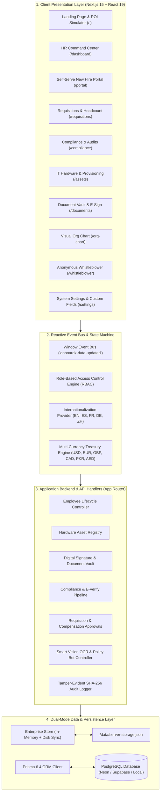

# OnboardX Enterprise
### Modern Employee Onboarding & People Operations Operating System

[](https://nextjs.org/)
[](https://react.dev/)
[](https://www.typescriptlang.org/)
[](https://tailwindcss.com/)
[](https://www.prisma.io/)
[](./test/unit-tests.mjs)

---

## 1. Project Overview

**OnboardX** is an enterprise-grade operational onboarding platform engineered for high-growth tech companies, modern SMEs, and multi-department organizations. It transforms fragmented new-hire paperwork, IT equipment provisioning, compliance certifications, and training checklists into a synchronized, deterministic state machine.

Instead of relying on disconnected email threads, physical papers, and manual spreadsheets, OnboardX enforces strict role-based handoffs between **Recruiting, Finance, IT Provisioning, Legal/People Operations, and the New Hire**.

---

## 2. Software Architecture

OnboardX follows a modular, decoupled architecture leveraging Next.js 15 App Router, React 19 Server and Client Components, a cross-window reactive event stream, and a dual-mode storage engine.



### Architectural Highlights
- **Unified Event Bus (`lib/events.ts`)**: Components broadcast structured events (`notifyDataChanged`) when mutations occur. Mounted pages update their state reactively without page reloads.
- **Zero-Stall Fallback Storage (`lib/db.ts`)**: Built-in state machine keeps data in memory and serializes safely to local disk. For cloud serverless deployments, Prisma ORM connects seamlessly to any PostgreSQL database.
- **Cryptographic Attestation (`lib/audit.ts`)**: Every signed contract, I-9 submission, and administrative action generates an immutable SHA-256 fingerprint recorded in the audit ledger.

---

## 3. Technology Stack

| Category | Technology | Version | Purpose in OnboardX |
| :--- | :--- | :--- | :--- |
| **Framework** | **Next.js** | `15.2.0` | React App Router, Server Components, API routes, Turbopack bundling |
| **UI Library** | **React** | `19.0.0` | Declarative UI, Concurrent Mode, React Server Components |
| **Language** | **TypeScript** | `5.8.2` | Strict type safety, interface contracts, automated type validation |
| **Styling** | **Tailwind CSS** | `3.4.17` | Utility-first styling with custom Warm Ivory, Pine, and Graphite design system |
| **Icons** | **Lucide React** | `1.16.0` | Crisp, semantic SVG iconography across dashboards and navigation |
| **Database ORM** | **Prisma** | `6.4.1` | Type-safe database client and automated schema migrations |
| **Database Engine** | **PostgreSQL** | `16+` | Relational storage for multi-tenant users, employees, and assets |
| **Interactive Canvas** | **HTML5 Canvas** | Native | Touch-friendly signature pad for in-browser digital document execution |
| **Confetti FX** | **Canvas-Confetti**| `1.9.4` | Milestone celebration animations upon onboarding certification completion |
| **Date Management**| **date-fns** | `4.1.0` | Immutable date calculations, probation tracking, SLA deadlines |
| **Validation** | **Zod** | `3.24.2` | Schema parsing, API request validation, and form error trapping |
| **Testing** | **Node Test Runner**| `Node 20+` | Zero-dependency native unit test suite for crypto and business logic |

---

## 4. Key Functional Modules

### 1. HR Command Center (`/dashboard`)
- Executive onboarding pipeline with live cohort breakdown: `Invited`, `In Progress`, `Review Pending`, and `Completed`.
- Real-time SLA bottleneck monitoring (e.g. flagging employees needing review before Day 1).
- **Multi-Currency Payroll Preparation**: Real-time compensation totals, annualized run-rates, and average comp per hire converted across 6 global currencies.
- Bulk CSV import/export for automated batch roster generation.

### 2. Self-Serve New Hire Portal (`/portal`)
- **Interactive Checklist**: Step-by-step onboarding milestones with due-day indicators and instant progress recalculation.
- **Self-Serve Benefits**: Company-subsidized health, vision, dental, and 401(k) election with dynamic monthly cost formatting.
- **Hardware & Credentials**: View dispatched workstation serial numbers, tracking status, and request peripheral hardware.
- **SCORM Training Player**: Interactive e-learning module playback supporting SCORM 1.2 / 2004 compliance packages.
- **Office Desk Map**: Visual interactive floor plan indicating building wing, desk number, and proximity to teammates.
- **Automated 1-on-1 Scheduler**: Instant calendar alignment with assigned mentors and hiring managers.

### 3. Job Requisitions & Headcount Planning (`/requisitions`)
- Multi-tiered approval workflow linking department hiring requests to Finance budget approvals.
- Dynamic compensation band conversion based on selected active currency.
- Direct requisition-to-onboarding conversion upon offer acceptance.

### 4. Compliance & Audit Center (`/compliance`)
- **Professional Certifications**: Track mandatory licenses, expiration dates, and renewal workflows.
- **Background Checks**: Integration architecture with screening providers (SSN trace, criminal history).
- **E-Verify Verification**: Federal employment eligibility case management.
- **Whistleblower Portal**: Zero-knowledge encrypted submission and token tracking channel.

### 5. IT Inventory & Asset Provisioning (`/assets`)
- Serial number tracking for laptops, external 4K monitors, and hardware security tokens (YubiKeys).
- Real-time asset lifecycle management: `IN_STOCK`, `PROVISIONED`, `ASSIGNED`, `RETURNED`.
- Automated hardware reservation triggered by offer letter signing.

### 6. Digital Document Vault (`/documents`)
- In-browser legal agreement and tax form signing with HTML5 canvas.
- Automatic generation of cryptographic **Attestation Certificates** with immutable SHA-256 digests and UTC timestamps.
- Template assignment engine with custom field population.

### 7. Interactive Org Chart (`/org-chart`)
- Dynamic organizational hierarchy tree with collapsible reporting lines.
- Filter by department, search by title, and inspect manager-to-report relationships.

---

## 5. Directory Structure

```text
OnboardX/
├── app/                              # Next.js 15 App Router pages & API handlers
│   ├── ai/                           # AI Hub (OCR Vision, Policy Q&A Bot)
│   ├── api/v1/                       # REST API endpoints (employees, assets, currency, etc.)
│   ├── assets/                       # IT Hardware inventory & provisioning
│   ├── compliance/                   # Compliance, Certifications, E-Verify
│   ├── dashboard/                    # HR Command Center & Cohort Roster
│   ├── documents/                    # Digital Document Vault & Signature Verification
│   ├── employees/                    # Employee Directory & Dossier Profiles
│   │   └── [id]/                     # Detailed Employee Record & Timeline
│   ├── login/                        # Passwordless login & persona switcher
│   ├── org-chart/                    # Interactive visual reporting hierarchy
│   ├── portal/                       # New Hire Self-Serve Experience
│   ├── requisitions/                 # Headcount planning & job approvals
│   ├── settings/                     # Tenant settings, custom fields, audit logs
│   ├── whistleblower/                # Zero-knowledge whistleblower channel
│   ├── globals.css                   # Design tokens, custom scrollbars, solid backgrounds
│   ├── layout.tsx                    # Root layout with navigation & footer
│   └── page.tsx                      # Editorial landing page & ROI calculator
├── components/                       # Reusable React UI components
│   ├── auth/                         # RoleGuard component for RBAC enforcement
│   ├── branding/                     # Official logos and Gateway mark
│   ├── collaboration/                # Slack bot simulator modal
│   ├── dashboard/                    # CurrencySwitcher, DEI analytics modal
│   ├── employees/                    # Custom fields cards and dossier widgets
│   ├── navigation/                   # Global Navbar, role switcher, notification drawer
│   ├── portal/                       # SCORM player, office map, calendar scheduler
│   ├── theme/                        # Theme toggle (Dark / Light mode)
│   └── ui/                           # Button, Card, Badge, ProgressRing, SignaturePad
├── data/                             # Local disk-synced persistence store
│   └── server-storage.json           # Active tenant dataset
├── lib/                              # Core utilities & business logic
│   ├── audit.ts                      # Cryptographic SHA-256 attestation functions
│   ├── constants.ts                  # Exchange rates, system defaults, design tokens
│   ├── currency.ts                   # Multi-currency formatting & role benchmarks
│   ├── db.ts                         # Enterprise in-memory + disk-sync database
│   ├── events.ts                     # Cross-component reactive event stream
│   ├── i18n.tsx                      # Multi-language translation engine
│   ├── notifications.ts              # Notification storage & event dispatch
│   ├── rbac.ts                       # Role-Based Access Control matrix & demo personas
│   ├── types.ts                      # TypeScript data contracts & interfaces
│   └── utils.ts                      # Class merging & general helpers
├── prisma/                           # Database schema & migrations
│   ├── schema.prisma                 # 18 PostgreSQL relational data models
│   └── seed.ts                       # Seeding script for enterprise demo data
├── public/                           # Static assets, logos, and emblems
├── test/                             # Automated testing suite
│   └── unit-tests.mjs                # Native Node.js test runner suite (15 tests)
├── deployment.md                     # Zero-Dollar ($0) free cloud deployment guide
├── package.json                      # Scripts and dependencies
├── tailwind.config.ts                # Custom typography and palette tokens
└── tsconfig.json                     # Strict TypeScript compiler options
```

---

## 6. Role-Based Access Control (RBAC) Matrix

OnboardX implements strict client and server role-based authorization:

| System Module | `ADMIN` | `HR_MANAGER` | `IT_PROVISIONER` | `EMPLOYEE` |
| :--- | :---: | :---: | :---: | :---: |
| **Landing Page & Public Portal** | Full | Full | Full | Full |
| **HR Command Center (`/dashboard`)** | Full | Full | Hardware Only | Read-Only |
| **New Hire Portal (`/portal`)** | Full | Full | Read-Only | Full Access |
| **Requisitions (`/requisitions`)** | Full | Full | Read-Only | Restricted |
| **IT Asset Inventory (`/assets`)** | Full | Read-Only | Full Access | Restricted |
| **Document Vault (`/documents`)** | Full | Full | Restricted | Restricted |
| **Compliance & Audits (`/compliance`)**| Full | Full | Restricted | Restricted |
| **System Settings (`/settings`)** | Full | Restricted | Restricted | Restricted |

---

## 7. Local Development & Quickstart

### Prerequisites
- **Node.js**: `v20.x` or higher
- **npm**: `v10.x` or higher
- **Git**

### Installation Steps

1. **Clone the repository:**
   ```bash
   git clone https://github.com/YOUR_ORGANIZATION/onboardx.git
   cd onboardx
   ```

2. **Install project dependencies:**
   ```bash
   npm install
   ```

3. **Configure Environment Variables:**
   Copy the example environment template:
   ```bash
   cp .env.example .env
   ```
   *Note: OnboardX runs out of the box with zero external dependencies using its built-in in-memory engine.*

4. **Start the local development server:**
   ```bash
   npm run dev
   ```
   Open [http://localhost:3000](http://localhost:3000) in your browser.

5. **Run the Automated Test Suite:**
   ```bash
   npm run test
   ```
   Executes all 15 native unit tests covering encryption, masking, metrics, and multi-currency exchange rates.

6. **Validate TypeScript Compilation:**
   ```bash
   npx tsc --noEmit
   ```

---

## 8. Zero-Dollar ($0) Free Cloud Deployment

For a detailed step-by-step walkthrough covering 100% free cloud deployment across **Vercel**, **Neon Serverless PostgreSQL**, **Render**, and **Oracle Cloud Always Free**, please refer to:

👉 **[deployment.md](./deployment.md)**

---

## 9. License

This project is licensed under the **MIT License**.
